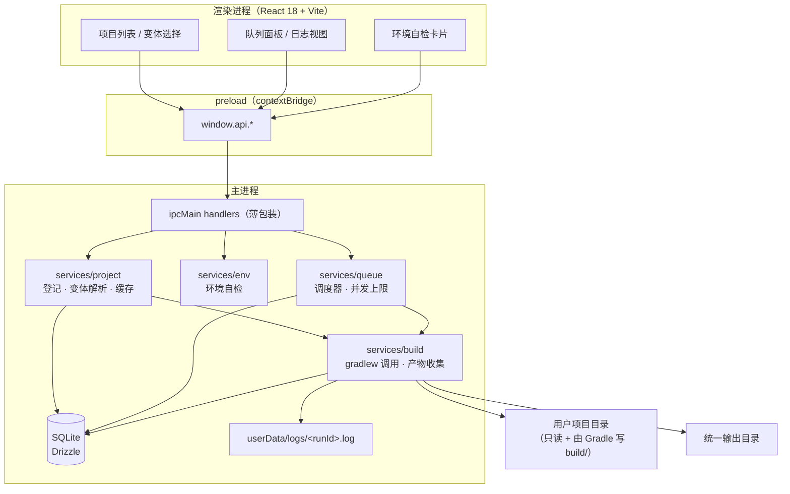
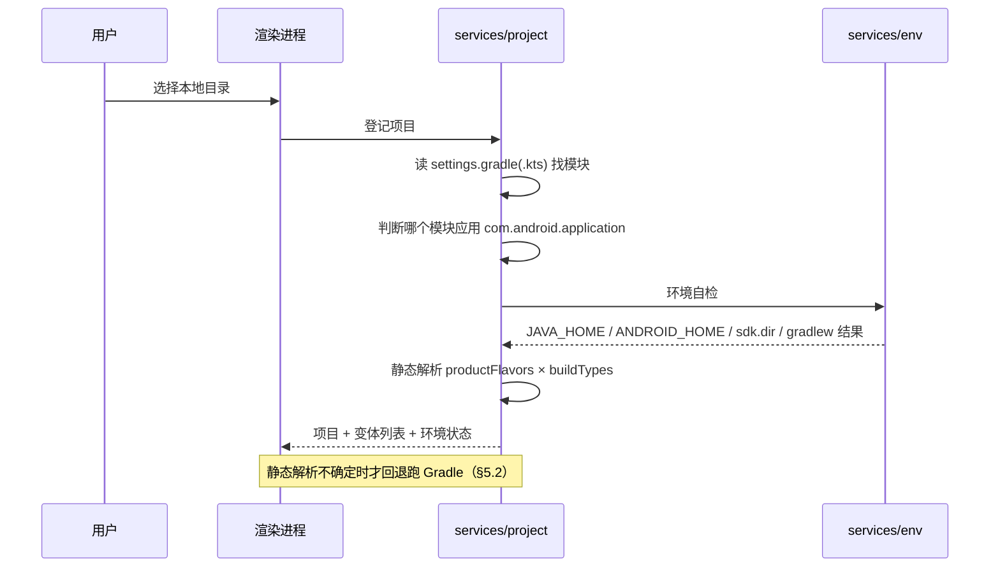
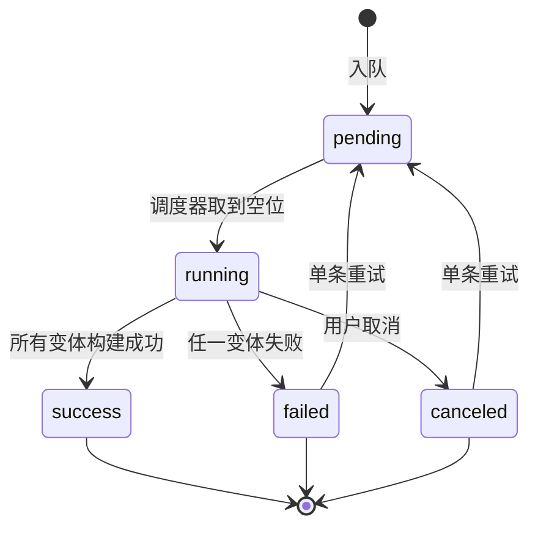

# 技术设计：安卓项目批量打包工具

> 前置：需求、已定决策 D1–D10、验收标准见 [prd.md](./prd.md)。本文只写实现方式与取舍。
> 界面视觉与交互遵循根目录 [DESIGN.md](<../../../../DESIGN.md>)（中性单色桌面界面规范 v1.0），落地细节见本文 §11。

## 1. 范围与前提

- 第一期只处理**本地目录**形式的 Android 项目（D9）。
- 构建环境复用本机已装的 JDK / Android SDK（D2），工具不做工具链下载与版本匹配。
- 产物复制到统一目录、保留原始文件名（D7）；release 未签名只标注（D10）。
- 目标平台：Windows 优先（`gradlew.bat` 走 `cmd.exe`），macOS/Linux 保持代码路径可复用但不作为第一期验收对象。

## 2. 架构与边界

沿用本项目 `.trellis/spec/` 的既有约定：Electron 三进程、IPC 走 contextBridge、类型以 Zod 为源头、主进程服务按 domain 分目录、持久化用 Drizzle + better-sqlite3、时间戳用 `timestamp_ms`、日志用 `logger.scope()`。



边界约定：

- **渲染进程不碰文件系统、不起进程**，所有 IO 与进程操作在主进程。
- **不修改用户项目**：唯一例外是 Gradle 自己写 `build/`；工具不注入 wrapper、不改 `build.gradle`、不写 `local.properties`。变体枚举用 `--init-script` 外部注入（见 §5.2）。
- 统一输出目录由用户指定，工具只在其中按项目建子目录。

## 3. 目录结构（对齐 spec 约定）

工程结构按 `.trellis/spec/shared/pnpm-electron-setup.md`（pnpm monorepo + `apps/desktop`），分层按 `.trellis/spec/backend/directory-structure.md`：

```
apk-build-release/
├── .npmrc                     # shamefully-hoist=true, strict-peer-dependencies=false
├── pnpm-workspace.yaml        # packages: apps/*, packages/*
├── package.json               # 根：dev / build / package / lint / typecheck + postinstall 重建 native module
├── apps/
│   └── desktop/
│       ├── package.json
│       ├── electron-builder 或 forge 配置
│       └── src/
│           ├── main/
│           │   ├── index.ts
│           │   ├── db/
│           │   │   ├── client.ts        # Drizzle + better-sqlite3 客户端
│           │   │   └── schema.ts        # projects / project_variants / queue_items / build_runs
│           │   ├── services/
│           │   │   ├── env/             # 环境自检：JAVA_HOME / ANDROID_HOME / sdk.dir / gradlew
│           │   │   │   └── types.ts  procedures.ts  lib/probe.ts
│           │   │   ├── project/         # 项目登记、变体解析与缓存
│           │   │   │   └── types.ts  procedures.ts  lib/parse-gradle.ts  lib/gradle-fallback.ts
│           │   │   ├── build/           # gradlew 调用、日志流、产物收集、取消
│           │   │   │   └── types.ts  procedures.ts  lib/spawn-gradle.ts  lib/artifacts.ts  lib/cancel.ts
│           │   │   └── queue/           # 调度器：并发上限、状态机、重试、清空
│           │   │       └── types.ts  procedures.ts  lib/scheduler.ts
│           │   └── ipc/                 # 各 domain 的 handler 注册（薄包装）
│           ├── preload/index.ts         # contextBridge.exposeInMainWorld('api', ...)
│           ├── renderer/
│           │   └── src/
│           │       ├── styles/{index,tokens,base}.css + components/ layout/ pages/
│           │       ├── components/  pages/  hooks/
│           │       └── ...
│           └── shared/
│               ├── constants/channels.ts   # IPC 频道常量
│               └── types/                  # Zod schema，渲染进程用 @shared 别名
└── packages/                  # 第一期不拆，留位
```

**native module 注意**：`better-sqlite3` 是 C++ 模块，必须在主进程的 Vite 配置里 `external`，并靠 `@electron/rebuild` 或 `electron-builder install-app-deps` 针对 Electron 的 Node 版本重建（spec `pnpm-electron-setup.md` 的 Native Modules 一节）。这一步没做对的表现是开发期正常、打包后启动即崩。

## 4. 数据模型

| 表 | 关键字段 | 说明 |
| --- | --- | --- |
| `projects` | `id`, `name`, `path`(unique), `app_module`, `selected_variants`(JSON), `variants_source`, `variants_signature`, `variants_notes`(JSON), `variants_resolved_at`, `created_at`, `updated_at` | 一条 = 一个本地项目目录；`variants_signature` 是构建文件 mtime 组合，`variants_notes` 存静态解析的已知限制 |
| `project_variants` | `project_id`, `name`, `flavor`, `build_type`, `source`(`static`/`gradle`), `resolved_at` | 变体解析结果缓存；`source` 记录它是怎么来的 |
| `queue_items` | `id`, `project_id`, `state`, `enqueued_at`, `started_at`, `finished_at`, `attempt` | 一条 = 一个项目的一次排队（D6）；直接构建也会建一条，阶段 4 的调度器复用同一条路径 |
| `build_runs` | `id`, `queue_item_id`, `variant`, `state`, `exit_code`, `log_path`, `apk_path`, `apk_name`, `application_id`, `version_name`, `version_code`, `signed`, `failure_kind`, `failure_hint`, `started_at`, `finished_at` | 一条 = 一个变体的一次构建；`failure_kind` 分类（oom / missing-sdk / java-version / timeout / gradle / unknown），`failure_hint` 是给用户看的一行原因 |
| `settings` | `key`(pk), `value`, `updated_at` | 键值配置，目前只放统一输出目录 `output.root`（默认「文档/APK批量打包」），设置界面在阶段 5 接入 |

- 时间戳统一 `timestamp_ms`。
- 日志**不进库**：写 `userData/logs/<runId>.log`，库里只存 `log_path`，避免大文本撑爆 SQLite。
- 历史列表用游标分页（spec 约定），按 `started_at` 倒序。
- 建表是幂等 `CREATE TABLE IF NOT EXISTS` + `PRAGMA table_info` 补列（`ensureColumn`），没有迁移历史要保留；等有真实数据要升级时再切 drizzle-kit。
- 项目解析缓存键 = 相关文件（`settings.gradle(.kts)`、各模块 `build.gradle(.kts)`、`gradle-wrapper.properties`）的 mtime 组合，存在 `project_variants.resolved_at` + 一个 `source_mtimes` 字段里。

## 5. 核心流程

### 5.1 添加项目



### 5.2 变体枚举（两级）

1. **静态解析**（默认路径）：读 `settings.gradle[.kts]` 的 `include` 得到模块列表；读各模块 `build.gradle[.kts]`，判断插件是 `com.android.application` 还是 `com.android.library`；抓 `productFlavors` / `buildTypes` 里的名字，组合成变体名（无 flavor 时只有 `debug` / `release`）。
2. **回退跑 Gradle**（静态解析失败、结果为空、或用户点「刷新变体」）：用 `--init-script` 注入一段脚本，在配置阶段打印变体名，再解析 stdout。脚本不改用户项目：

```groovy
// tool-variant-probe.init.gradle（由工具生成到 userData 下，不写入项目目录）
allprojects { p ->
    p.plugins.withId('com.android.application') {
        p.extensions.configure(com.android.build.api.variant.AndroidComponentsExtension) { ac ->
            ac.onVariants(ac.selector().all()) { v ->
                println "TOOL_VARIANT:${p.path}:${v.name}"
            }
        }
    }
}
```

调用形如 `gradlew --init-script <probe> :app:help --console=plain`（任意任务都会走配置阶段）。

**已知限制（照抄 androkit 记录并自行验证）**：静态解析拿不到 flavor 的 `applicationId` 覆盖/后缀，也读不出 `buildSrc` 里动态生成的变体；这两类必须走回退。因此变体列表要带 `source` 字段，UI 上对 `static` 结果给「刷新变体」入口。

**回退方案本身也需要实测**：`onVariants` 的回调注册时机在配置阶段（[AndroidComponentsExtension](https://developer.android.com/reference/tools/gradle-api/9.3/com/android/build/api/variant/AndroidComponentsExtension)），所以必须挑一个会走配置阶段的任务来触发（`:app:help` 够用）；init script 里要用 `p.extensions.configure(...)` 而不是直接引用 `androidComponents` 扩展，否则在脚本求值顺序上会拿到空对象。这条列入阶段 0.5 的 spike。

### 5.3 队列执行



- 调度器是主进程内单例，维护 `并发上限`（默认 1，可调 2–3，D5）的信号量；取到空位才把 `queue_items.state` 置 `running`。
- **一条队列项内部顺序执行该项目的多个变体**（D6）：每个变体一次 `gradlew` 调用，原因是失败可归因到具体变体、取消与重试粒度清晰。代价是每个变体都付一次配置阶段；不采用「一次调用传多个 assemble 任务」的合并优化（会让失败定位与产物对应变含糊）。
- 不强制 `--no-daemon`：沿用项目自身的 daemon 设置以复用 JVM、加快后续构建。副作用是不同 JVM 参数的构建会各起一个 daemon（内存翻倍），这与并发上限一起在 §8 记录。
- 命令：`cmd.exe /d /s /c "<项目>\gradlew.bat" :<module>:assemble<Variant> --console=plain`（`--console=plain` 让输出可稳定解析）。
- 进度不做百分比承诺：只给「阶段（配置 / 执行 / 打包）+ 已耗时 + 实时日志」。Gradle 的 `> Task :app:xxx` 行可以做粗粒度任务流展示，但不作为进度条依据。

### 5.4 取消

Windows 上 `gradlew.bat` 是 `cmd.exe → java.exe` 两层，只杀第一层会留孤儿进程，所以：

1. 发送中断（Windows `CTRL_BREAK_EVENT` / Unix `SIGINT`），给一个宽限期；
2. 宽限期内没退出则 `taskkill /PID <pid> /T /F`（Unix `SIGKILL` 进程组）；
3. `queue_item` 置 `canceled`，当前 `build_run` 记 `exit_code` 与「已取消」标记。

不默认执行 `gradlew --stop`：那会停掉同版本的全部 daemon，影响并发中的其他项目。

**Gradle 侧已知问题（决定这条要留退路）**：Windows 上中断不杀子进程是长期问题（[gradle#7603](https://github.com/gradle/gradle/issues/7603)、[gradle#18716](https://github.com/gradle/gradle/issues/18716)、[gradle#21260](https://github.com/gradle/gradle/issues/21260)），Gradle 到 [PR #33596](https://github.com/gradle/gradle/pull/33596) 才用 Java 9+ 的 `ProcessHandle.descendants()` 销毁进程树；取消路径本身也修过（[PR #32333](https://github.com/gradle/gradle/pull/32333)）。Node 侧同理：`child.kill()` 只杀直接子进程，Windows 上必须走 `taskkill /T /F`（[node#64406](https://github.com/nodejs/node/issues/64406)、[nx 的 tree-kill 修复](https://github.com/nrwl/nx/commit/89cf29d5c616b162b3dc253ef9c5af9d1d02a95) 就是为 Gradle 这种深进程树做的）。

**实测结论（阶段 4 已验）**：在真实项目上于构建配置阶段发取消 → `queue_items` 与 `build_runs` 都置为 `canceled`、日志文件大小在取消后 14 秒内不再增长、`gradlew --status` 显示所有守护进程都是 `IDLE`（没有 BUSY）。所以「杀客户端进程树」这条路径够用，不需要额外 `gradlew --stop`；守护进程留着复用是预期行为，不算残留。

### 5.5 产物收集

1. 构建成功后**递归查找**项目内的 `*/build/outputs/apk/**/output-metadata.json`（多模块 + 多变体），**不能按 `<variant>` 拼固定路径** —— 实测 AGP 7.4.2 的布局是 `outputs/apk/<flavor>/<buildType>/`，AGP 8.x 起才是 `outputs/apk/<variant>/`。同时过滤 `androidTest` 等测试产物目录。
2. 从 `output-metadata.json` 取 `applicationId` / `variantName` / `elements[].versionCode` / `elements[].versionName` / `elements[].outputFile`；`elements` 是数组（split 会有多元素），不要取单值。
3. 复制到统一输出目录，**保留原始文件名**（D7），目录内按项目分子目录避免同名覆盖。
4. 签名检测：用 SDK `build-tools/*/apksigner` 执行 `apksigner verify --print-certs <apk>`（[apksigner 文档](https://developer.android.com/tools/apksigner)）；未装 build-tools 时降级为文件名含 `-unsigned` 的判断，并把结果标成「未验证」而不是「已签名」。检测结果写 `build_runs.signed`，UI 对未签名给明确标注（D10）。

实测依据（见 `research/spike-0.5-findings.md`）：样本项目 `defaultConfig` 写 `com.fdapp.mylove`，真实 applicationId 是 `com.demo.sampleb`（flavor 用 buildSrc 常量覆盖），产物名是项目自定义的 `示例B_V1.0.0_debug包_20261012_1025.apk`。**元数据只能来自产物，不能来自静态解析。**

## 6. IPC 契约（示意）

| 频道 | 方向 | 载荷 | 返回 |
| --- | --- | --- | --- |
| `env:probe` | invoke | 无 | 环境自检结果 |
| `project:add` | invoke | `{ path }` | 项目 + 变体列表 |
| `project:refreshVariants` | invoke | `{ projectId, force: boolean }` | 变体列表（`force` 直接走 Gradle 回退） |
| `project:setVariants` | invoke | `{ projectId, variants: string[] }` | 更新后的项目 |
| `queue:enqueue` | invoke | `{ projectIds: string[] }` | 新增的队列项 |
| `queue:setConcurrency` | invoke | `{ limit: 1..3 }` | 生效值 |
| `queue:cancel` | invoke | `{ itemId }` | 取消结果 |
| `queue:retry` | invoke | `{ itemId }` | 新队列项 |
| `queue:clear` | invoke | `{ scope: 'finished' \| 'all' }` | 受影响条数 |
| `build:log` | **事件推送** | `{ runId, chunk }` | — |
| `build:state` | **事件推送** | `{ itemId, state, run }` | — |

所有载荷类型从 `src/shared/types/` 的 Zod schema 推导；handler 只做参数校验 + 调用 service，不写业务逻辑（spec 约定）。

## 7. 兼容性与迁移

- 仓库当前是空工程（无 `package.json`、无源码、非 git 仓库），无历史数据、无迁移。
- 需要新建 Electron + Vite + React + TS 脚手架，并按 `.trellis/spec/shared/pnpm-electron-setup.md` 用 pnpm 管理依赖。

## 8. 关键取舍

| 取舍 | 选择 | 理由 | 代价 |
| --- | --- | --- | --- |
| 变体枚举路径 | 静态解析优先，不确定回退 Gradle（D4） | 添加项目秒出列表；冷项目跑 Gradle 要下发行版与依赖，不能默认走 | 列表可能缺项，需要 `source` 标注与手动刷新 |
| 工具链 | 复用本机环境（D2） | 待打包项目已在本机跑过，环境已存在 | 环境不一致的失败回到用户；靠环境自检缓解 |
| 变体粒度 | 一变体一次 `gradlew`（§5.3） | 失败可归因、取消/重试粒度清晰 | 多变体项目多付几次配置阶段 |
| 队列并发 | 默认 1，可调 2–3（D5） | 并发能让多项目批量出包更快 | 多 daemon 内存叠加，OOM 风险 |
| 产物 | 复制到统一目录、保留原名（D7） | 多项目产物集中可查 | 需要按项目分子目录，否则同名覆盖 |
| daemon | 不强制禁用 | 复用 JVM 显著加速重复构建 | 并发下 JVM 参数不同会多起 daemon |

## 9. 未验证假设与验证方式

阶段 0.5 已跑完前三条里的两条半，实测结论见 `research/spike-0.5-findings.md`。下表标注当前状态。

| 假设 | 状态 | 实测结论 / 退路 |
| --- | --- | --- |
| `--init-script` + `onVariants` 能在不改项目的前提下打印变体名 | ✅ 成立 | 样本项目上 `gradlew --init-script <probe> :app:help --console=plain` 11 秒返回，输出 `TOOL_VARIANT::app:sampleBDebug` / `sampleBRelease`；用 `p.extensions.findByName('androidComponents')` + 鸭子类型调用即可，不必引用 AGP 类；项目文件 mtime 未变 |
| 变体列表能靠静态解析拿到 | ✅ 列表成立，元数据不成立 | 变体名能从 `productFlavors` 块名拼出；但 applicationId / versionName / 产物名会被 flavor 与 buildSrc 常量覆盖，**元数据只能取产物里的 `output-metadata.json`** |
| `output-metadata.json` 存在且字段稳定 | ✅ 成立（AGP 7.4.2 实测） | 字段齐全（version 3 / applicationId / variantName / elements[].versionCode / versionName / outputFile）；但目录布局随 AGP 版本变（7.x 是 `<flavor>/<buildType>/`，8.x 是 `<variant>/`），必须递归查找 |
| 取消后 daemon 不再继续该构建、不残留半成品 APK | ✅ 阶段 4 已验 | 真实项目上取消：日志停止增长、`gradlew --status` 全为 `IDLE`、状态置 `canceled`；守护进程留着复用属预期，不算残留 |
| 并发 2–3 不会把机器打死 | ✅ 阶段 4 已验（2 并发） | 两个真实项目并发上限设 2：`peakRunning=2`（两项启动时间差 19ms）、双双 success、总耗时 59.8 秒（串行需要 ~75 秒以上），机器没出现内存告警；3 并发仍未实测，默认上限保持 1、由用户显式调高 |
| `sdk.dir` 失效时 AGP 的兜底行为 | ✅ 阶段 5 已验 | `local.properties` 的 `sdk.dir` 指向**不存在**的路径时，AGP 会回退到 `ANDROID_HOME`（合成项目因此构建成功）；要复现「缺 SDK」必须指向存在但没有 platforms 的空目录。环境自检里的「冲突」提示因此更有必要 |

## 10. 运维与回滚

- 日志：`userData/logs/`，按 `runId` 分文件；提供「清理历史日志」入口，不做自动轮转（第一期）。
- 删除项目只删登记与缓存，**不动用户项目目录里的任何文件**。
- 统一输出目录里的旧产物不自动清理，避免误删用户要的东西。
- 异常退出（进程被杀）后重启：把仍处 `running` 的 `queue_items` 与 `build_runs` 标成 `failed`（原因记为「工具异常退出」），不自动续跑。
- 回滚点：本项目为新建，回滚 = 删掉新建的源码目录，不涉及数据迁移。

## 11. 界面设计系统（遵循 DESIGN.md）

### 11.1 令牌落地与冲突解决

- `src/renderer/src/styles/tokens.css` 放 DESIGN.md 第 11 节的 `:root` 与 `.dark` 两段，**逐字复制不改值**。
- 入口 CSS 追加 Tailwind v4 映射：`@theme inline { --color-background: var(--background); ... }`（DESIGN.md 第 11 节末段）。必须用 `inline` —— 工具类才会引用变量本身、跟随 `.dark` 切换；用 `@theme` 会在构建期把值固化（[Tailwind 主题变量](https://tailwindcss.com/docs/theme)、[`@theme inline` 讨论](https://github.com/tailwindlabs/tailwindcss/discussions/17826)）。
- 阴影不用 `shadow-*` 工具类：在 `styles/base.css` 里写**不带 `@layer`** 的 `.shadow-card` / `.shadow-float`（不带层的样式永远赢过带层的）；浮层描边用 `border` 而不是 `ring-1`。原因见 DESIGN.md §4：`--tw-shadow` 与 `--tw-ring-shadow` 共用同一条 `box-shadow` 声明，任一变量无效整条作废，且 `ring-*` 会盖住 `shadow-*`。
- 文件组织仍按 `.trellis/spec/frontend/css-design.md`：`styles/{index,tokens,base}.css` + `components/` + `layout/` + `pages/`，`index.css` 导入顺序固定，组件样式用 BEM 命名。

### 11.2 布局骨架

```
┌─ 顶栏 48px ── 应用名 · 环境自检状态 · [开始构建]（每屏唯一实心按钮） ─┐
├──────────────┬────────────────────────────────────────────────────────┤
│ 侧栏 272px   │ 主区：项目卡片 / 队列面板 / 构建详情（日志）           │
│ 可拖动       │ 内容列吸收剩余宽度                                     │
│ 200–420px    │                                                       │
└──────────────┴────────────────────────────────────────────────────────┘
```

- 侧栏宽度写 `--sidebar-width`，拖动后写 `localStorage['sidebar-width']`（DESIGN.md 指定的 key）。开发与生产 origin 不同会各存一份，可接受。
- 最小窗口 1024×680；不用 `100vh`，用 flex 让内容列吸收剩余宽度。

### 11.3 区域与组件

| 区域 | 组件 | 关键点 |
| --- | --- | --- |
| 侧栏 | 项目列表项 | hover 用 `--muted`，当前项用 `--sidebar-accent`，变体数量用徽章 |
| 顶栏 | 主按钮「开始构建」 | 每屏只有一个实心按钮；环境自检未通过时禁用 |
| 主区 | 项目卡片 | 双层结构（外壳 28px + 6px 内边距 + 内芯 22px）；内含变体多选与「刷新变体」ghost 按钮 |
| 主区 | 队列面板 | 表格：表头 `--muted` + 12px 次要色，行高 40–48px，状态与耗时列右对齐加 tabular-nums |
| 主区 | 构建详情 | 日志区独立滚动；阶段徽章；产物卡片（路径 + 元数据 + 复制按钮） |
| 主区 | 环境自检卡片 | 缺项用 `warning`，通过用 `success` |
| 对话框 | 设置（并发上限、统一输出目录） | 圆角 28px、`--shadow-float`、`max-height: 85vh`、底部 sticky 按钮条 |
| 行内 | 删除项目 / 清空队列 | `destructive` 变体（10% 底 + 同色字），与主按钮视觉分开 |

### 11.4 状态呈现（一律「10% 浅底 + 同色深字」）

| 语义 | 令牌 | 用在哪 |
| --- | --- | --- |
| 等待 | `--muted` + `--muted-foreground` | 队列项 pending |
| 运行中 | `--info` | running 与阶段徽章 |
| 成功 | `--success` | success、环境自检通过 |
| 未签名 / 缺 SDK | `--warning` | release 未签名标注 |
| 失败 | `--destructive` | failed、构建错误 |
| 已取消 | `--muted` | canceled |

- 版本号、versionCode、耗时、计数一律 `.tabular`（`font-variant-numeric: tabular-nums`）。
- 队列状态变化用 `role="status"` + `aria-live="polite"` 播报，读屏能听到。

### 11.5 字体

- 渲染进程入口引入 `@fontsource-variable/geist`（npm v5.3.0，已核实存在），自托管，不走 CDN —— Electron 离线环境不能依赖 Google Fonts。
- 字体栈按 DESIGN.md 原样，中文回退必须显式写：`'Geist Variable', 'Microsoft YaHei UI', 'Microsoft YaHei', 'PingFang SC', 'Noto Sans CJK SC', system-ui, sans-serif`。
- 图标用 `lucide-react`（tree-shakable，渲染为内联 SVG，符合 DESIGN.md「不用 emoji、全项目一套 SVG 图标」的要求），不用 emoji。
- **深色不接线**（D11）：`.dark` 段照抄进 `tokens.css` 但不挂类、不做切换、不跟随 `prefers-color-scheme`。因为所有颜色都走令牌，第二期只需加切换开关 + 持久化。

### 11.6 无障碍落地检查

- 可点元素四态齐全：默认 / hover / 按下（位移 1px 或底色深一档）/ `:focus-visible` 焦点环。
- 图标按钮带 `aria-label`；对话框做焦点陷阱并支持 Esc 关闭。
- `prefers-reduced-motion: reduce` 下动效降到 0.01ms（DESIGN.md 第 11 节 CSS 已含这段）。
- 对比度：正文用 `--foreground`；次要文字 `--muted-foreground` 对 `--card` 约 5.3:1，过 AA。
