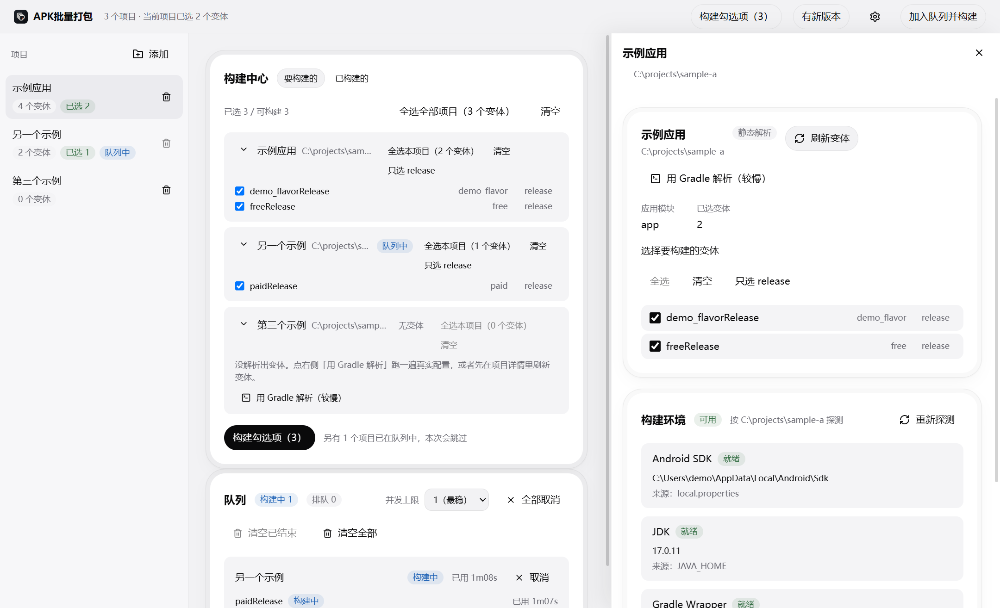
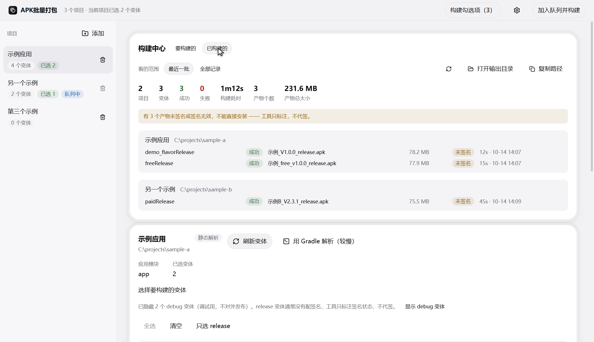

# APK批量打包

**中文** ｜ [English](README.en.md)

[](LICENSE)

[](https://github.com/DHHHhhhe/Apk-Build-Release/releases)

把多个 Android 项目排成一队，勾好变体，一次打完，产物集中落到一个目录里。

日常场景：手上有好几个安卓项目要出包，每个还得挑变体（flavor × buildType），一个个开 IDE 点 Build 很烦。

**它复用你本机已有的构建环境** —— 你的项目本来能跑起来，这里就能跑，不需要另外配 JDK、Android SDK 或 Gradle。



## 目录

- [它能做什么](#它能做什么)
- [快速开始](#快速开始)
- [界面](#界面)
- [变体：默认只管发布变体](#变体默认只管发布变体)
- [数据放在哪](#数据放在哪)
- [已知注意事项](#已知注意事项)
- [常见问题](#常见问题)
- [从源码构建](#从源码构建)
- [发布新版本](#发布新版本)
- [许可证](#许可证)

## 它能做什么

| 能力 | 说明 |
| --- | --- |
| 多项目批量出包 | 一次登记多个本地项目，按并发上限排队构建，一条失败不影响后面的 |
| 跨项目批量选择 | 「构建中心」在一处列出所有项目的可构建变体，勾好一次入队；已在队列中的项目自动跳过并说明 |
| 变体列表来自项目自身 | 静态解析 `settings.gradle` 与各模块 `build.gradle`（毫秒级），解析不可信时回退跑 Gradle；不写死 debug / release |
| 产物集中收集 | 读 AGP 生成的 `output-metadata.json`，取 `applicationId` / `versionCode` / `versionName`，按项目分子目录复制到统一目录 |
| 结果汇总 | 一个面板看全「这一批出了哪些包」：项目、变体、成功失败、总耗时、产物总大小、每个包的路径与签名状态 |
| 签名状态标注 | 用 SDK 里的 `apksigner` 校验产物；未签名时明确标注「不能直接安装」。只标注，不代签 |
| 失败能定位 | 把 OOM、缺 SDK 组件、JDK 版本不符、超时等分开，每类给一句能动手的建议 |
| 构建日志 | 实时流到界面，可过滤关键字、只看报错；完整日志落盘，一键打开 |
| 取消 / 重试 / 清空 | 取消会杀掉整棵 Gradle 进程树，不留孤儿 `java.exe` |
| 构建完成通知 | 跑长构建时可以切走 |
| 自动更新（安装版） | 启动后自动查一次 GitHub Releases，发现新版本时右下角出现提示，可看更新内容、下载、重启并安装；手动检查的结果也从右下角通知返回。入口在侧栏左下角的版本行 |

## 快速开始

**第 1 步：下载装上**

到 [Releases](https://github.com/DHHHhhhe/Apk-Build-Release/releases) 下载，两种形态任选一个：

| 包 | 适合 | 说明 |
| --- | --- | --- |
| `apk-batch-build-<版本>-setup.exe` | 长期用 | 安装版，安装路径可以自己选；开始菜单与桌面有快捷方式 |


> 后续更新由应用自己完成（启动后自动查一次）。自动更新下来的新版本同样会被 SmartScreen 拦一次 —— 这是没有代码签名证书的代价，不是文件损坏。

> 第一次打开会被 Windows SmartScreen 拦一下（没有代码签名证书，发布者显示为「未知发布者」）。点「更多信息」→「仍要运行」即可，不是文件损坏。

**第 2 步：添加项目**

点侧栏「添加」选项目根目录（含 `settings.gradle` 那一层），也可以直接把文件夹**拖进窗口**。

添加只读配置文件，毫秒级完成，不会真的跑一条 Gradle。

**第 3 步：勾变体**

在「构建中心 · 要构建的」里勾选。这里一次列出**所有项目**的可构建变体，不用逐个进项目；也能按项目全选、清空、只选某个 buildType。

工具只出 **release** 包，列表里就是这些变体。

**第 4 步：入队**

点「构建勾选项（N）」—— 表内和右上角是同一个动作。已在队列中的项目会自动跳过，并在按钮旁说明跳过了几个。

跑完切到「构建中心 · 已构建的」看这一批出了哪些包，点「打开输出目录」或「复制路径」。

## 界面

左侧是项目列表，主内容列只放**全局**内容（构建中心与队列）。想看某个项目的变体来源、环境自检与构建记录，点左侧项目，右侧打开抽屉。

侧栏左下角是几条常驻控件：**主题**（跟随系统 / 浅色 / 深色）、**自动检查更新**开关、**版本号**（点开看历次更新记录）与**检查更新**。发现新版本时，右下角会浮出提示条，把这一版改了什么摆出来，下不下由你点；下载中显示进度，下载完给「立即重启并更新」。


「构建中心」有两个视图：**要构建的**（跨项目勾选 + 发起构建）与**已构建的**（这批产物的汇总）。



| 区块 | 作用 |
| --- | --- |
| 构建中心 · 要构建的 | 跨项目勾选表：按项目分组列出可构建变体，显示「已选 X / 可构建 Y」；无变体的项目给出原因与「用 Gradle 解析」入口 |
| 构建中心 · 已构建的 | 结果汇总：指标行 + 按项目分组的产物清单（文件名、大小、签名状态、完成时间） |
| 队列 | 每条队列项是一个项目、下面按变体展开，能看到每个变体的状态与耗时；支持取消、重试、清空 |
| 项目抽屉 | 点左侧项目打开：变体选择、变体来源与限制、构建环境自检、该项目的构建记录。非模态，开着的时候主列照样能操作；`Esc` 关闭 |

环境自检与构建记录放在抽屉里，是因为这两项都要按项目取数（各一次探测 / 查询）：放进全局区域就会变成「一打开界面就并发探测所有项目」。

## 变体：只出 release 包

工具只构建 `release` 变体。项目如果一个 `release` 变体都没有，就把全部列出来 —— 否则你会面对一个空列表。

列表显示与真正入队用的是**同一条规则**，不存在「列表里看不见的变体照样被打包」。

## 数据放在哪

| 内容 | 位置 |
| --- | --- |
| 统一输出目录（APK 复制到这里） | 「文档/APK批量打包」，可在**设置**里改 |
| SQLite 库（项目、队列、构建记录） | 安装版：`%APPDATA%\@abr\desktop\app.db`；开发模式：`apps/desktop/app-dev.db` |
| 运行日志 | `%APPDATA%\@abr\desktop\logs\main.log` |
| 每个变体的构建日志 | `%APPDATA%\@abr\desktop\logs\<runId>.log` |
| Gradle 探针脚本 | `%APPDATA%\@abr\desktop\gradle-probe\` |

数据与安装目录分开，卸载不会连数据一起删。

**工具会动你的项目吗？不会。** 读 Gradle 配置、跑 `gradlew`、把产物复制出去，仅此而已；探针脚本写在应用数据目录，只在构建时通过 `--init-script` 传入，不落进你的项目。

## 已知注意事项

### 输入要求

| 项 | 要求 |
| --- | --- |
| 操作系统 | **Windows**（目前只在这一个平台验证过） |
| 本机环境 | JDK（AGP 8.x 需要 17）、Android SDK（`ANDROID_HOME` 已设或项目里有 `local.properties`）；Gradle 用项目自带的 wrapper |
| 项目 | **本地目录**，不能填 Git 地址或远程路径 |
| 联网 | 工具本身不联网、不上传任何数据；构建时是否联网取决于你的项目依赖 |

### 其他

- **不代签 APK**：release 变体通常没有配签名，打出来是未签名的，工具只标注。
- **不管理工具链**：不下载 JDK / SDK / Gradle，缺什么要你自己装。这是刻意的 —— 复用你项目本来就能用的那套环境，比工具自己塞一套更不容易出岔子。
- **并发默认 1**：实测并发 2 能同时跑两个真实项目（总耗时从 75 秒降到 60 秒左右），但更吃内存，上限 3。
- **日志渲染上限**：界面单次最多留 20 万字符、渲染 2000 行，超出的只在落盘日志里。
- **仓库里没有 exe**：安装包在 [Releases](https://github.com/DHHHhhhe/Apk-Build-Release/releases)，源码仓库不含构建产物。

## 常见问题

**添加项目后变体是空的？**
项目可能用变量动态生成 flavor，静态解析读不出。点卡片上的「用 Gradle 解析（较慢）」，它会真跑一遍配置阶段。

**添加很快，但变体不全？**
这是设计如此：添加只做静态解析（毫秒级），避免在 Gradle 上干等。要准确列表时显式点 Gradle 解析。

**构建完找不到 APK？**
产物行会显示落盘路径；提示「没定位到该变体的 APK」说明项目自定义了输出目录，工具按 `output-metadata.json` 找不到它。

**上次跑到一半我强杀了应用，队列一直转圈？**
不会。启动时会把残留的运行中记录标成失败并写明原因，不会自动续跑。

**换电脑了，项目路径不一样怎么办？**
项目按路径登记，换机器要重新添加。数据在 `%APPDATA%\@abr\desktop`，可以一并拷过去。

## 从源码构建

想自己构建（改代码，或想在没验证过的平台上试）：

```bash
pnpm install          # 首次：装依赖（postinstall 会补 Electron 二进制）
pnpm dev              # 开发模式：Vite 服务 + Electron，热更新
pnpm start            # 先 build 再启动（等价于 pnpm preview）
pnpm test             # 单元与集成测试
pnpm typecheck        # 类型检查
pnpm package          # 打 Windows 安装包，产物在 apps/desktop/release
```

需要 Node.js ≥ 20 与 pnpm ≥ 9。

| 你想找的 | 位置 |
| --- | --- |
| Electron 入口（构建后） | `apps/desktop/package.json` 的 `main` → `out/main/index.js` |
| 主进程源码 | `apps/desktop/src/main/index.ts` |
| 渲染进程 | `apps/desktop/src/renderer/index.html` + `src/renderer/src/main.tsx` |
| 打包配置 | `apps/desktop/electron-builder.yml` |
| 图标母版 | `apps/desktop/build/icon.png`（electron-builder 自动转多尺寸 ico） |
| 界面视觉规范 | [DESIGN.md](DESIGN.md) |

```
apps/desktop/src/
├── main/       # 主进程：数据库、Gradle 调度、IPC handler
├── preload/    # contextBridge 暴露的 window.api
├── renderer/   # React 界面
└── shared/     # 跨层契约：IPC 频道、Zod 类型、常量
```

> `out/` 与 `release/` 都不入库，刚 clone 下来不存在，需要先 `pnpm build` 或 `pnpm start`。
> 改了代码记得重新构建 —— 跑的是 `out/` 里的产物，不是源码。

## 发布新版本

**正常路径是打标签让 CI 发**：推一个 `v<版本>` 标签，工作流会构建、核对版本号与更新记录、再发布。

```powershell
# 1. 抬版本号（根 package.json 与 apps/desktop/package.json 两处一起改）
# 2. 改 apps/desktop/build/release-notes.md（整份就是 Release 正文），
#    再 cd apps/desktop && pnpm changelog 把本版并进 CHANGELOG
# 3. 提交推送，然后打标签
git tag v<版本>
git push origin v<版本>
```

**手动发版（不走 CI）**：产物是 4 个，一个都不能少 —— 少了 `latest.yml` 客户端就查不到更新（装过的人只能重装），而这件事在发布页面上看不出来。

```powershell
pnpm package
gh release create v<版本> `
  apps/desktop/release/<版本>/apk-batch-build-<版本>-setup.exe `
  apps/desktop/release/<版本>/apk-batch-build-<版本>-setup.exe.blockmap `
  apps/desktop/release/<版本>/latest.yml `
  --title "v<版本>" --notes "..."
```

判据是「用户会不会感觉到这是一次更新」，不是改了几个文件。改了会影响产物内容的代码就抬版本并重新出包；只改文档不用。

## 许可证

[MIT](LICENSE)
